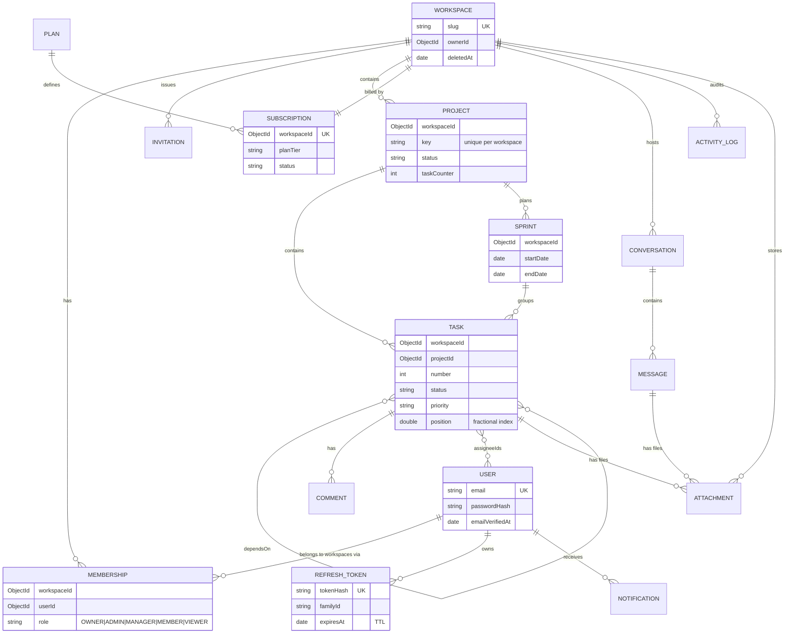

# NexusFlow – Data Model

## Tenancy rules

- Every collection except `users`, `workspaces`, `plans`, `refreshTokens` carries a **required** `workspaceId`
  and at least one index that **starts with** `workspaceId`. This is enforced by `tests/tenancy.schema.test.ts`.
- `memberships` is the single source of truth for access; the tenant-context middleware (next phase) resolves
  the workspace from the URL and verifies membership server-side on every request.
